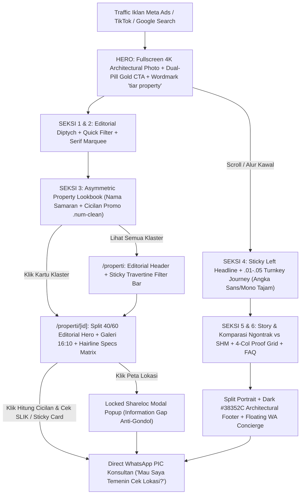

# 🗺️ USER FLOW & PAGE ARCHITECTURE BLUEPRINT (`Mejuma Warm Stone` × `Tiar Property`)

> **Dokumen Arsitektur Terkunci (2026-11-17)**
> Mengadopsi penuh **Opsi 1 (`Mejuma Warm Stone`)** dengan dua penyesuaian final user:
> 1. **Hapus Total Kalkulator KPR** di Homepage (`/`) dan di halaman Detail Unit (`/properti/[id]`), termasuk menghapus `KprCalculator.tsx` dan tautan `#kalkulator` di `Navbar.tsx`. Seluruh kebutuhan hitung cicilan & cek SLIK dialihkan ke CTA langsung WhatsApp PIC (*"Hitung Cicilan & Cek SLIK via WhatsApp"*).
> 2. **0% Serif Numerals:** Seluruh angka (`.01–.05`, `.01–.04`, harga, cicilan promo, dimensi `m²`, rating, statistik) wajib menggunakan `Golos Text` / `JetBrains Mono` (`.num-clean` lining-tabular), sementara `Cormorant Garamond` hanya untuk huruf editorial.

---

## 1. Visual & Conversion User Flow (Streamlined — Tanpa Kalkulator KPR)

---

## 2. Anatomi Perombakan Halaman demi Halaman

### A. Halaman Utama (`/` — `src/app/page.tsx`)

| Urutan | Nama Seksi | Komponen Target (`src/components/*`) | Layout & Konten Spesifik Tiar Property |
|---|---|---|---|
| **Nav** | **Detached Floating Pill Navbar + Top-Right Dark Drawer** | `Navbar.tsx` | Kiri: Monogram `TP · Tiar Property`. Kanan: Pill `Menu =` (`#E8E4E1`) + Pill `Konsultasi WA` (`#38352C`). Klik `Menu =` membuka **Top-Right Floating Dark Drawer (`#38352C`)** dengan indeks `.01–.04` (`.num-clean` sans-serif, **tanpa `#kalkulator`**). Disembunyikan di `/admin`. |
| **Seksi 0** | **Monumental Fullscreen Hero** | `Hero.tsx` | Foto arsitektur lokal 4K fullscreen (`h-[100svh] min-h-[680px]`). Blok editorial + **Dual-Pill Gold CTA** (`[Jelajahi Klaster Pilihan] [→]`). Bawah: **Giant Bleed Wordmark `tiar property`** (`Cormorant Garamond` roman `#FAF8F5`) dengan `flex flex-col justify-between` anti-overlap di `1280x800` & `375x812`. |
| **Seksi 1** | **Editorial Diptych Mission & Quick Filter** | `UspFeatureBar.tsx` & `SearchFilterBar.tsx` | Kanvas `#F1F1F1`. Grid `5-col` foto arsitektur portrait + `7-col` statement serif, 3 metrik angka `.num-clean`, serta **Quick Filter Strip** (`Semua Klaster`, `Sidoarjo & Juanda`, `Surabaya MERR & Barat`, `Cicilan < Rp 2 Jt`, `Rumah 2 Lantai`) dengan ikon `lucide-react` (`0` emoji). |
| **Seksi 2** | **Editorial Serif Marquee** | `PropertyCatalog.tsx` | Ticker horizontal mulus dengan aksen lingkaran emas `#FFCA4F` (patuh `prefers-reduced-motion`, angka pakai `.num-clean`). |
| **Seksi 3** | **Asymmetric Staggered Property Lookbook** | `PropertyCatalog.tsx` & `PropertyCard.tsx` | Grid asimetris (`7-col` landscape `16:10` + `5-col`/`4-col` portrait `4:5`, `minmax(0, 1fr)`). Metadata bersih di bawah foto (`codeName` samaran, `locationAreaShort`, `priceStart`, `cicilanPromo`, `UTJ` dalam `.num-clean`). **100% Information Gap**. |
| **Seksi 4** | **Sticky Left Title + `.01–.05` Turnkey KPR Journey** | `HeroOffers.tsx` | Kiri (`5-col` sticky): Judul serif *"Urusan berkas sampai akad biar kami yang kawal."* + Dual-Pill Gold CTA. Kanan (`7-col`): 5 kartu travertine `#E8E4E1` dengan indeks `.01–.05` memakai `.num-clean` (`Golos Text` tegas, **0% serif numerals**). |
| **Seksi 5** | **Editorial Story: Ngontrak vs Rumah Sendiri** | `ComparisonTable.tsx` | Statement editorial + tabel perbandingan travertine `#E8E4E1` vs `#38352C` (mobile stacked cards + desktop table) + CTA langsung **"Hitung Cicilan & Cek SLIK via WhatsApp"** (menggantikan fungsi konversi kalkulator). |
| **Seksi 6** | **4-Column Travertine Proof & Value Grid + FAQ** | `Testimonials.tsx` & `FaqSection.tsx` | 4 kartu vertikal `#E8E4E1` (`min-h-[260px]`, indeks `.01–.04` `.num-clean`, 0 italic quote slop) + Akordeon `
/
` border `#C5BEB4` + CTA WA. |
| **Footer** | **Split Portrait + Dark Panel Architectural Footer (`Ft2`)** | `Footer.tsx` | Pre-footer CTA + Kiri (`4-col`) foto portrait `3:4` + Kanan (`8-col`) panel `#38352C` (Navigasi tanpa `#kalkulator`, Area Surabaya–Sidoarjo, Kontak WA Mbak Ningsih, Portal Admin) & **Giant Wordmark `tiar property`** (`0` tech-stack leak). |

---

### B. Halaman Katalog Lengkap (`/properti` & `/produk` — `src/components/PropertiCatalogView.tsx`)
- Header editorial ala `mejuma-tuscany.com/properties` + Sticky Travertine Filter Bar dengan URL query sync (`?q=&kota=&tipe=&cicilan=`), Lucide icons, dan angka `.num-clean`.

### C. Halaman Detail Properti (`/properti/[id]` & `/produk/[id]` — `src/components/PropertyDetailView.tsx`)
- **Split 40/60 Editorial Hero** + Galeri `16:10` (swipe/drag + Lightbox Modal) + Hairline Specs Matrix (`1px solid #C5BEB4`, seluruh angka `.num-clean`) + `.01–.08` All-In Free.
- **Tanpa Mini-Kalkulator KPR:** Blok `#simulasi-kpr` dihapus total dan digantikan dengan kartu ajakan konsultasi langsung *"Hitung Cicilan & Cek SLIK via WhatsApp"* ke PIC unit.
- **Peta Statis & Locked Shareloc Modal Popup:** Pertahankan 100% `/images/maps/gmaps_sidoarjo.webp` & `gmaps_surabaya.webp` + modal popup bertema Warm Stone (`#F1F1F1` / `#38352C` / `#FFCA4F`), **ubah `"Partner PT TMJ"` -> `"Partner Resmi"`**, ganti emoji `🧍` -> Lucide icon.

### D. Halaman Direktori Konsultan (`/agen` — `src/components/AgentDirectoryView.tsx`)
- Header editorial + segmented filter (`Semua`, `Sidoarjo`, `Surabaya`) + 4-col portrait card `#E8E4E1` dengan rating `.num-clean` dan Dual-Pill WA CTA.

### E. Halaman Panel Admin (`/admin` — `src/components/admin/*`)
- **100% Non-Regression Guard:** Seluruh fitur PIN Lock (`2026`), CRUD Klaster, CRUD Agen, Image Compressor, dan JSON Export/Sync dipertahankan penuh.
